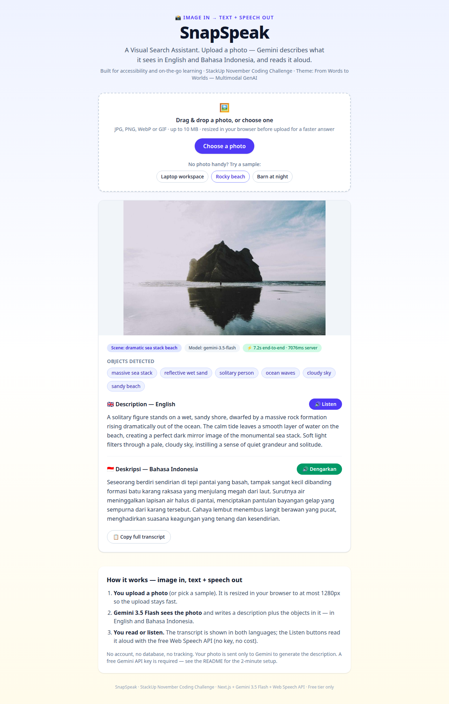
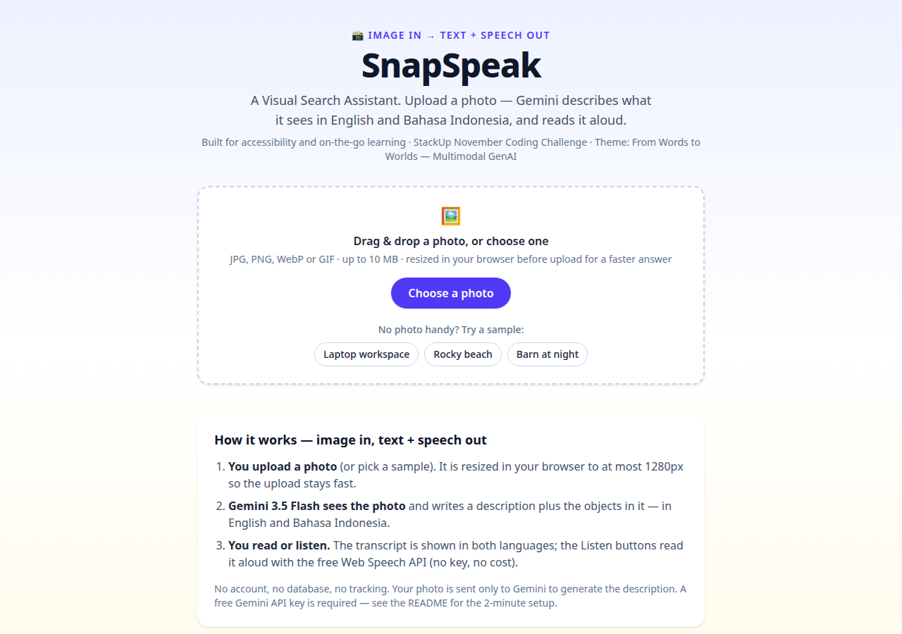
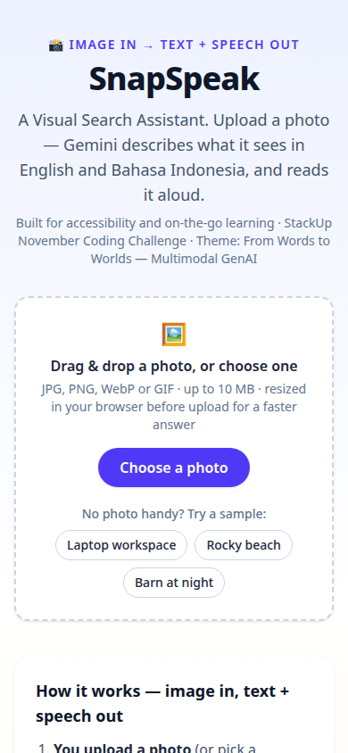

# 📸 SnapSpeak — Visual Search Assistant

> **Image in, text + speech out.** Upload a photo — Gemini describes what it sees in English and Bahasa Indonesia, and reads it aloud.

Built for the **StackUp November Coding Challenge** — Theme: *From Words to Worlds – Multimodal GenAI*, Challenge Statement 2: **Create a Visual Search Assistant** (image-to-text + speech synthesis, for accessibility and on-the-go learning).



## ✨ What it does

| Input | Output |
|---|---|
| 📷 Photo (upload, drag & drop, or a built-in sample) | 📝 Bilingual description — English + Bahasa Indonesia |
| | 🏷️ Detected objects as chips + a scene label |
| | 🔊 Spoken description in both languages (Listen / Dengarkan buttons) |
| | 📋 Copyable full transcript |

**The twist:** most visual assistants describe in one language. SnapSpeak describes in **two** — English for the world, Bahasa Indonesia for home — and reads both aloud, so it works for language learners, travellers, and people who prefer listening over reading.

## 🔄 How it works — modalities

```
Photo (image)
   │  ① resized in your browser to ≤1280px (JPEG 0.85) — faster upload
   ▼
POST /api/describe  (Next.js API route)
   │  ② Gemini 3.5 Flash (vision) — one call, strict JSON output
   ▼
Description EN + Description ID + objects + scene
   │  ③ shown as text, and spoken on demand
   ▼
Web Speech API (free, no key) — en-US voice for English,
id-ID voice for Bahasa Indonesia · Text transcript (copyable)
```

- **No account, no database, no tracking.** Your photo is sent only to Gemini to generate the description.
- **Free tier only:** Gemini free tier + the browser's built-in speech synthesis. No paid API, no key needed for speech.

## 🚀 Quick start

### Prerequisites

- Node.js 18+ and npm
- A **free** Gemini API key from [Google AI Studio](https://aistudio.google.com/apikey) (takes ~2 minutes, no card required)

### Install & run

```bash
git clone https://github.com/intemu2/snapspeak.git
cd snapspeak
npm install
cp .env.example .env.local   # then paste your key into .env.local
npm run dev                  # → http://localhost:3000
```

Production build:

```bash
npm run build
npm run start                # → http://localhost:3000
```

### Configuration

| Variable | Required | Default | Notes |
|---|---|---|---|
| `GEMINI_API_KEY` | ✅ yes | — | Free key from [AI Studio](https://aistudio.google.com/apikey). Never commit `.env.local`. |
| `GEMINI_MODEL` | no | `gemini-3.5-flash` | Must be a vision-capable Gemini model. Note: `gemini-2.5-flash` was retired for new API keys (returns HTTP 404), so the default is `3.5-flash`. Override here if Google retires it again. |

## 🖼️ Screenshots

| Landing page (desktop) | On mobile |
|---|---|
|  |  |

Try it without uploading anything: the three sample photos on the landing page (**Laptop workspace**, **Rocky beach**, **Barn at night**) run the full flow in one click. Sample photos: [Picsum](https://picsum.photos/) (Unsplash-sourced).

## ⚡ Performance (measured, 22 Nov 2026)

Measured end-to-end against the production build (`npm run start`) on this machine, with the three 900×600 sample photos (36–73 KB) and a Gemini free-tier key. Latency is dominated by Gemini inference; the client-side resize keeps the upload itself to a few KB.

| Sample photo | Server (`latency_ms`) | End-to-end in browser |
|---|---|---|
| Laptop workspace (73 KB) | 9,729 ms (first call, cold) | — |
| Rocky beach (36 KB) | 6,799 ms / 7,076 ms | 7.2 s / 7.7 s |
| Barn at night (43 KB) | 6,971 ms | 7.0 s |

- **Typical answer: ~7 seconds** for a 900×600 photo.
- **Build:** `next build` clean, 0 errors. First Load JS **107 kB** (`/` route 4.06 kB).
- **Optimizations:** (1) client-side resize to max 1280px / JPEG 0.85 before upload — a 10 MB phone photo becomes a few hundred KB; (2) single Gemini call returning all fields (EN + ID + objects + scene) instead of 2–3 calls; (3) `responseMimeType: "application/json"` so the model returns strict JSON — no re-tries spent on malformed output; (4) no database, no extra round-trips.

## 🛡️ Error handling

Every failure shows a plain-language message in the UI plus a machine-readable code — the app never fails silently:

| Code | When | What the user sees |
|---|---|---|
| `MISSING_API_KEY` | no `GEMINI_API_KEY` set | Setup instructions with the AI Studio link |
| `INVALID_API_KEY` | Gemini rejects the key (HTTP 400/403) | "Check GEMINI_API_KEY in .env.local…" |
| `NO_IMAGE` / `INVALID_IMAGE` | no file / not a photo | "Please upload a JPG, PNG, WebP or GIF image." |
| `IMAGE_TOO_LARGE` | photo over 10 MB | Size shown, "please choose a smaller photo" |
| `RATE_LIMITED` | Gemini free-tier quota (HTTP 429) | "Wait a minute and try again." |
| `GEMINI_UNREACHABLE` / `GEMINI_ERROR` | network / Gemini error | "Could not reach Gemini… try again." |
| `PARSE_ERROR` | unreadable model answer | "Try again — it usually works on the next attempt." |

Speech: if the browser has no speech synthesis, the Listen buttons are disabled and a notice explains the text transcript still works.

## 🧱 Project structure

```
snapspeak/
├── src/app/
│   ├── page.tsx              # UI: upload / drag-drop / samples / results / TTS
│   ├── layout.tsx            # metadata + font
│   ├── globals.css           # Tailwind v4
│   └── api/describe/
│       └── route.ts          # POST /api/describe — validation + Gemini call
├── public/
│   ├── favicon.svg
│   └── samples/              # 3 built-in sample photos
├── docs/
│   ├── screenshot-desktop.png
│   ├── screenshot-mobile.png
│   └── screenshot-result.png
├── .env.example              # copy to .env.local, paste your free key
├── package.json
└── README.md
```

**Stack:** Next.js 15 (App Router, TypeScript) · Tailwind CSS v4 · Gemini 3.5 Flash (`generativelanguage.googleapis.com`, REST, no SDK needed) · Web Speech API for text-to-speech.

## ⚠️ Known limitations (honest notes)

- **Speech quality depends on the browser/OS voices.** The Listen buttons call `speechSynthesis.speak()` with `en-US` / `id-ID` voices and pick the closest installed voice. In headless Chromium (0 voices installed) the call runs without errors but produces no sound — audio was verified by code path, not by listening. On a normal desktop/mobile browser with system voices, it speaks.
- **~7 s per photo** is Gemini inference time on the free tier, not rendering — it varies with model load.
- **Model names change.** Google retired `gemini-2.5-flash` for new keys during development; if `gemini-3.5-flash` is ever retired, set `GEMINI_MODEL` to the current Flash model.

## 📄 License

MIT — free to use and remix.
